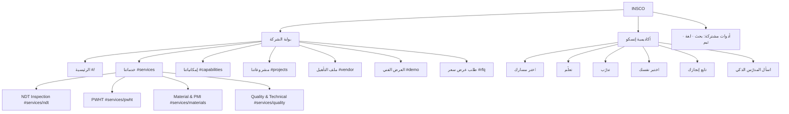
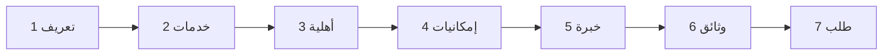
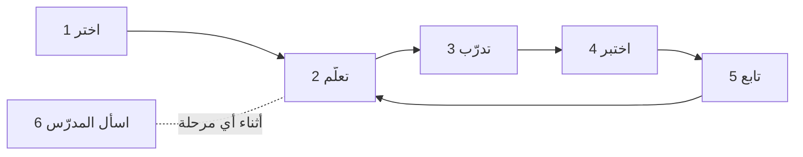

# خطة تجربة المستخدم (UX) — INSCO Corporate & Academy

> **حالة الملف:** مسودة للمراجعة والاعتماد — لم يُعدَّل أي كود واجهة بناءً عليها بعد.
> **التاريخ:** 2026-11-17 · **الفرع:** `arena/bb0450d4-inscondteg`
> **المرافق البصري:** [`wireframes.html`](./wireframes.html) — ثماني لوحات تفاعلية (RTL) تُفتح في المتصفح.
> **الهدف:** تحويل الموقع من «مجموعة وظائف» إلى مسارين واضحين: مسار تجاري يوصل إلى طلب عرض سعر، ومسار تعليمي يوصل إلى كفاءة فعلية.

---

## 1. الخلاصة التنفيذية

الملاحظة الأساسية في مراجعتك صحيحة، وأقوى دليل عليها رقمي لا ذوقي:

| المؤشر | الواقع الحالي (من الكود) |
| --- | --- |
| أقسام الصفحة الرئيسية قبل أي اعتماد | **9 أقسام** (خدمات، حاسبة، أسطول، 3D، PWHT، أفلام RT، معمل UT، ثم الشهادات) |
| الشهادات والاعتمادات | تظهر في القسم **الـ10** من الرئيسية |
| سابقة الأعمال | تظهر في القسم **الـ13** من الرئيسية |
| أزرار التنقل على الموبايل | **14** اختصاراً في شريط لاصق |
| روابط سطح المكتب | **8** روابط بمجموعة مختلفة عن الموبايل |
| تبويبات الأكاديمية | **33** تبويباً داخل **6** صناديق غير مرتبة برحلة |
| ترتيب CTA في الـ Hero | بروشور → أكاديمية → طلب تسعير (التحويل آخراً) |

التشخيص إذن: **الموقع يعرض كل ما يملك قبل أن يجيب على أسئلة المشتري الأربعة** (ماذا تقدّم؟ هل أنت مؤهل؟ هل لديك خبرة ومعدات؟ كيف أطلب؟). والنتيجة أن الزائر التجاري يمشي في معرض أدوات لا في مسار بيع.

**قرار التصميم المقترح:** بوابتان صريحتان + صفحة رئيسية تجارية من 8 محطات + صفحة «عرض فني» مستقلة تستضيف كل المحاكيات + أكاديمية من 6 محطات رحلة. **لا حذف لأي وظيفة أو بيانات أو محتوى**، ونفس الهوية اللونية والخطية.

---

## 2. الحالة الحالية — خريطة موثّقة من الكود

هذا القسم مرجع للتنفيذ؛ كل بند مقرون بملفه الحقيقي.

### 2.1 المسار التجاري

`src/App.tsx` يبدّل بين `currentView = 'company' | 'academy'`، والرئيسية تُركَّب من `src/components/company/CompanyPortal.tsx` بهذا الترتيب:

| # | المكوّن | ملاحظة |
| --- | --- | --- |
| 0 | شريط 14 اختصاراً (`quickNav`) | موبايل فقط، لاصق، `top-[57px]` |
| 1 | `CompanyHero` | CTA: بروشور → أكاديمية → طلب تسعير |
| 2 | `CompanyQuickActionsSection` | يخلط طلب التسعير بتحميل المنهج التدريبي |
| 3 | `CompanyServicesSection` | 12 طريقة + أسطول PWHT |
| 4 | `CompanyProjectCostEstimator` | حاسبة تفاعلية |
| 5 | `CompanyFleetInspector` | 48+ معدة مع حالة معايرة مشتقة من التاريخ |
| 6 | `AdvancedMotionVisualizerSection` | هولوغرام 3D + معرض صور |
| 7 | `PwhtCycleSimulator` | محاكي دورة حرارية |
| 8 | `RadiographicFilmViewer` | عارض أفلام RT |
| 9 | `CompanyUltrasonicLabSection` | معمل UT/PAUT |
| 10 | `CompanyCertificationsSection` | ISO ثلاثية، IRCA، ENRRA |
| 11 | `CompanyStandardsMatrix` | ASME / API / AWS / ISO |
| 12 | `CompanyAcademyHighlight` | جسر للأكاديمية |
| 13 | `CompanyProjectsSection` | 18 مشروعاً |
| 14 | `CompanyTestimonialsSection` | شهادات عملاء |
| 15 | `CompanyVendorVaultSection` | بروشور 50 صفحة + ملاحق A–E |
| 16 | `CompanyContactSection` | اتصال 24/7 + نموذج RFQ |

### 2.2 الأكاديمية

`src/academyTabs.ts` يعرّف **33** قيمة `#hash`. `src/components/EducationalAcademy.tsx` يجمعها في 6 صناديق:

| الصندوق الحالي | التبويبات |
| --- | --- |
| الكتب والموسوعة | `encyclopedia` `knowledge` `edb` |
| المناهج والمسارات | `curriculum` `courses` `paths` |
| اختبارات NDT وإفادة التعلم | `certificates` `certification_center` `practical` `exam_simulation` |
| معامل المحاكاة | `workshops` `sim_labs_rt` `sim_labs_ar` `ar_rt_codes` `ge_exposure_time` |
| المحاكيات وأجهزة الفحص | `pwht_curve` `weld_simulator` `dac_builder` `v1_v2_calibration` `defects` `paut_controller` `rt_lab` `rt_techniques` |
| الأكواد والمستشار والمسار | `standards` `methods` `quiz` `flashcards` `ask_ai` `video_gen` `leaderboard` `completion_map` `roadmap` |

الخلل: الصندوق الأخير يجمع أربعة أشياء لا علاقة بينها (مراجع، اختبار، ذكاء اصطناعي، متابعة)، والصندوق الأول يخلط «تعلّم» بـ«مرجع». المتعلم لا يعرف من أين يبدأ.

### 2.3 ما هو جيد ويجب الحفاظ عليه

- الهوية: كحلي `#0B1026`، سماوي `#22D3EE`، كهرماني `#FBBF24` — مؤسسية وصناعية وتناسب القطاع.
- حالة المعايرة المشتقة من التاريخ (لا معايرة منتهية تُعرض سارية).
- روابط عميقة تعمل (`#quiz`, `#rt_lab` …) — أُبقيت عبر `readAcademyTab`.
- دعم RTL/LTR والوضع الفاتح/الداكن.
- بنية RFQ الآمنة (لا نجاح قبل تأكيد التسليم).

---

## 3. خريطة الموقع المستهدفة

### 3.1 المخطط



### 3.2 الشجرة النصية

```
/  (اختيار البوابة — أول زيارة)
├── #/                       الشركة: 8 محطات
│   ├── #services            عائلات الخدمات الأربع
│   │   ├── #services/ndt
│   │   ├── #services/pwht
│   │   ├── #services/materials
│   │   └── #services/quality
│   ├── #capabilities        الأسطول + الخريطة + المعايرة
│   ├── #projects            18 مشروعاً + شهادات العملاء
│   ├── #vendor              البروشور + الملاحق + قائمة الوثائق
│   ├── #demo                العرض الفني (5 أدوات)
│   └── #rfq                 النموذج + الحاسبة كخطوة اختيارية
└── #academy                 الأكاديمية: 6 محطات
    ├── #academy/paths       (ما يعادل #paths #curriculum #courses #methods)
    ├── #academy/learn       (#encyclopedia #knowledge #edb #flashcards #standards)
    ├── #academy/practice    (14 تبويباً — الجدول في 6.2)
    ├── #academy/test        (#quiz #exam_simulation #practical #certification_center)
    ├── #academy/progress    (#completion_map #roadmap #leaderboard #certificates)
    └── #academy/tutor       (#ask_ai #video_gen)
```

**عقد الروابط (مهم):** كل `#hash` مسطّح قائم يُعامَل كاختصار يفتح المحطة الصحيحة. لا نكسر رابطاً منشوراً في وثيقة أو بريد عميل. الشكل `#academy/<station>` هو العنوان القانوني الجديد اختيارياً، والمسطّح يبقى صالحاً.

### 3.3 أين تذهب مكوّنات اليوم (ضمان عدم الحذف)

| المكوّن الحالي | الموقع الجديد |
| --- | --- |
| `CompanyHero` | محطة 1 (بنفس الصورة والبيانات، وإعادة ترتيب الأزرار) |
| `CompanyQuickActionsSection` | يُلغى الشريط؛ محتواه يوزَّع: زر التسعير في الـ Hero، وتحويل المنهج داخل `#academy` |
| `CompanyServicesSection` | محطة 2 + صفحات `#services/*` |
| `CompanyProjectCostEstimator` | خطوة اختيارية داخل `#rfq` (نفس المكوّن) |
| `CompanyFleetInspector` + `CompanyRegionalFleetMap` | محطة 4 «إمكانياتنا» |
| `AdvancedMotionVisualizerSection` | `#demo` |
| `PwhtCycleSimulator` | `#demo` |
| `RadiographicFilmViewer` | `#demo` |
| `CompanyUltrasonicLabSection` | `#demo` |
| `CompanyCertificationsSection` + `CompanyStandardsMatrix` | محطة 3 «لماذا إنسكو؟» (مضغوطة بلا حذف نص) |
| `CompanyProjectsSection` + `CompanyTestimonialsSection` | محطة 5 «سابقة الأعمال» |
| `CompanyVendorVaultSection` | محطة 6 + `#vendor` |
| `CompanyContactSection` | محطة 7 + `#rfq` |
| `CompanyAcademyHighlight` | شريط جسر واحد بين البوابتين (لا قسم كامل) |

---

## 4. رحلة العميل التجاري

الهدف الوحيد: **قرار شراء أو طلب عرض سعر.** كل محطة لها سؤال واحد تجيب عليه.



| # | المحطة | سؤال الزائر | المحتوى | الإجراء الأساسي | مؤشر النجاح |
| --- | --- | --- | --- | --- | --- |
| 1 | Hero | من أنتم وماذا تفعلون؟ | صورة صناعية + جملة واحدة + شريط اعتمادات | اطلب عرض سعر | نسبة النقر على CTA |
| 2 | الخدمات | هل تقدّمون ما أحتاجه؟ | 4 عائلات + الطرق + الأكواد | تفاصيل الخدمة | فتح صفحة خدمة |
| 3 | لماذا إنسكو | هل أنتم مؤهلون؟ | ISO/EGAC/ENRRA/ndt.org + كفاءات + أكواد | تحميل ملف التأهيل | تحميل PDF |
| 4 | الإمكانيات | هل لديكم معدات وقدرة تغطية؟ | 16 وحدة 65 kW · 48+ معدة · خريطة · معايرة | شاهد العرض الفني | فتح `#demo` |
| 5 | سابقة الأعمال | من عملتم له؟ | 18 مشروعاً + شهادات | تصفح المشروعات | وقت القراءة |
| 6 | ملف التأهيل | كيف أسجّلكم كمورد؟ | بروشور + ملاحق A–E + قائمة وثائق | تحميل | اكتمال التحميل |
| 7 | طلب عرض سعر | كيف أطلب؟ | نموذج 3 خطوات + حاسبة اختيارية | إرسال | **طلب مؤكَّد بمرجع** |

**قواعد الرحلة:**

1. الـ Hero يحتوي زراً أساسياً واحداً (كهرماني) = «اطلب عرض سعر»، وثانوياً واحداً = «ملف الشركة». الأكاديمية تُنقل إلى الترويسة.
2. لا يُعرض أي مكوّن تفاعلي ثقيل قبل محطة 4.
3. كل محطة تنتهي بإجراء ينقل للمحطة التالية أو للنموذج — لا محطة نهائية بلا مخرج.
4. لا نجاح قبل تأكيد التسليم (قاعدة قائمة في `src/rfq/submit.ts`، تُحفظ كما هي).
5. المشتري الذي لا يقرأ: شريط اعتمادات + ملف PDF يكفيان للتأهيل المبدئي.

---

## 5. رحلة المتعلم



| المحطة | سؤال المتعلم | المحتوى | الإجراء |
| --- | --- | --- | --- |
| 1 · اختر مسارك | من أين أبدأ وبأي مستوى؟ | مسارات التعلم · 8 تخصصات · 7 مقررات NDE-Ed · 12 طريقة | «ابدأ المسار» |
| 2 · تعلّم | بماذا أتعلم؟ | موسوعة · دروس · كتب تفاعلية · EDB · بطاقات مراجعة · جداول · أكواد | «افتح الدرس» |
| 3 · تدرّب | كيف أمارس بلا جهاز؟ | 14 معملاً ومحاكياً (RT/PAUT/UT/PWHT/DAC/عيوب/معايرة) | «شغّل المعمل» |
| 4 · اختبر | هل أتقنت؟ | بنك أسئلة · محاكاة امتحان · تقييم عملي · مركز اعتماد | «ابدأ الاختبار» |
| 5 · تابع | أين وصلت؟ | خريطة إنجاز · خارطة طريق · لوحة متصدرين · إفادة تعلّم ذاتي **غير معتمدة** | «استخرج الإفادة» |
| 6 · اسأل | ما لم أفهمه | مستشار يستشهد من 132 وثيقة، أو يقول صراحةً «غير مهيّأ» | «اسأل» |

**قواعد الرحلة:**

1. صفحة `#academy` تبدأ بـ«أكمل من حيث توقفت» (المصدر: `localStorage` الموجود) قبل أي شبكة أدوات.
2. كل محطة تعرض 3–6 مداخل فقط؛ الباقي داخل المحطة نفسها.
3. لا تُنتزع لغة الاعتماد الأكاديمي: «إفادة تعلّم ذاتي غير معتمدة» تبقى كما اعتمدتها المراجعة.
4. المعامل الثقيلة تُحمَّل عند الطلب (lazy) — الأكاديمية أصلاً code-split.

---

## 6. التنقل

### 6.1 سطح المكتب

```
[INSCO]  الرئيسية · خدماتنا · إمكانياتنا · مشروعاتنا · ملف التأهيل · الأكاديمية     [🔍] [EN] [🌓]  ( اطلب عرض سعر )
```

- 6 روابط تجارية + رابط أكاديمية واحد + زر تحويل واحد.
- «العرض الفني» رابط ثانوي داخل صفحة خدمة وفي التذييل (ليس في الصف العلوي).
- العنصر النشط يُعلَّم بـ `aria-current="page"`.

### 6.2 الموبايل

- زر قائمة واحد (`aria-expanded`) يفتح درجاً بمجموعتين: **الشركة** و**الأكاديمية**، ثم «خيارات» (لغة/ثيم/بحث).
- شريط سفلي ثابت بزرّين: «اطلب عرض سعر» و«تواصل/واتساب».
- شريط الـ14 اختصاراً يُلغى.
- الدرج: تركيز محصور، Esc يغلق، منع تمرير الخلفية.

### 6.3 لوحة الأكاديمية

شريط محطات أفقي من 6 عناصر (اختر/تعلّم/تدرّب/اختبر/تابع/اسأل) مع الحفاظ على التبويبات الفرعية داخل كل محطة. أي `#hash` قديم يفتح المحطة الصحيحة ويُبرز التبويب.

---

## 7. الوايرفريمز

المرجع البصري الكامل: `documentation/ux/wireframes.html` (ثماني لوحات). النسخة النصية المختصرة للرئيسية:

```
┌──────────────────────────── الترويسة ────────────────────────────┐
│ INSCO   الرئيسية خدماتنا إمكانياتنا مشروعاتنا ملف التأهيل الأكاديمية │ (اطلب عرض سعر)
├─────────────────────────────────────────────────────────────────┤
│ 1 · HERO: صورة صناعية + «هندسة النزاهة الإنشائية» + سطران        │
│     [اطلب عرض سعر] [ملف الشركة PDF]  ·  شريط الاعتمادات           │
├─────────────────────────────────────────────────────────────────┤
│ 2 · SERVICES: 4 بطاقات (NDT · PWHT · MATERIAL · QUALITY)         │
├─────────────────────────────────────────────────────────────────┤
│ 3 · WHY INSCO: شهادات + تراخيص + كفاءات + أكواد (مضغوطة)         │
├─────────────────────────────────────────────────────────────────┤
│ 4 · CAPABILITIES: 16×65kW · 48+ معدة · خريطة · حالة معايرة       │
├─────────────────────────────────────────────────────────────────┤
│ 5 · EXPERIENCE: 18 مشروعاً + شهادات عملاء                        │
├─────────────────────────────────────────────────────────────────┤
│ 6 · VENDOR: تحميل البروشور + ملاحق A–E                           │
├─────────────────────────────────────────────────────────────────┤
│ 7 · RFQ: 3 خطوات + حاسبة اختيارية                                │
├─────────────────────────────────────────────────────────────────┤
│ 8 · FOOTER: سجل تجاري · 24/7 · بريد · روابط                      │
└─────────────────────────────────────────────────────────────────┘
```

---

## 8. نظام التصميم (توحيد لا استبدال)

| العنصر | القاعدة |
| --- | --- |
| الألوان | كحلي `#0B1026` خلفية · `#111736` سطح · سماوي `#22D3EE` معلومات · كهرماني `#FBBF24` إجراء · أخضر/أحمر للحالة فقط |
| الأولوية اللونية | زر كهرماني واحد لكل شاشة؛ السماوي لا يُستخدم كخلفية زر تحويل |
| العناوين | سلّم 40/32/24/18/16/14/12px، H1 مرة واحدة لكل صفحة |
| البطاقة | حد واحد + سطح + عنوان + سطران + إجراء واحد؛ بلا تدرجات متعددة |
| المسافات | سلّم 4/8/12/16/24/32/48/64، والفواصل بين المحطات 64px على المكتب |
| الأزرار | ثلاث فئات: أساسي (كهرماني)، ثانوي (حدود)، رابط نصي — وحالة `focus-visible` إلزامية |
| الجداول | `overflow-x-auto` دائماً، ورؤوس ثابتة عند الطول |
| الحركة | ≤200ms للتفاعل، واحترام `prefers-reduced-motion` |
| RTL | `start/end` فقط، وفحص كل مكوّن بالعربية قبل الإنجليزية |
| الأيقونات | مجموعة `lucide-react` وحدها، بمقاس واحد لكل سياق |

**مكوّنات مشتركة مقترحة (تُنشأ مرة وتُستخدم):** `PageSection` · `SectionHeading` · `ServiceCard` · `StatTile` · `CtaButton` · `TrustStrip` · `DocumentCard`. الهدف تقليل الاختلاف بين 16 مكوّناً تجارياً مكتوبة يدوياً.

---

## 9. خطة التنفيذ (مراحل قابلة للاعتماد منفردة)

| المرحلة | العمل | معيار القبول | الملفات |
| --- | --- | --- | --- |
| **P0** ✅ | خريطة الموقع + الرحلتان + الوايرframes | هذا الملف + `wireframes.html` معتمَدان | `documentation/ux/*` |
| **P1** | هيكل البوابتين والتنقل | بوابة أول زيارة + 6 روابط + درج موبايل + إزالة شريط 14 | `App.tsx`, مكوّن `PortalChooser` جديد, `tests/routingAndLanguage` |
| **P2** | إعادة ترتيب الرئيسية | 8 محطات بالترتيب، Hero بزر واحد أساسي، الاعتمادات قبل المحاكيات | `CompanyPortal.tsx`, `CompanyHero.tsx` |
| **P3** | صفحة العرض الفني | `#demo` تضم 5 أدوات، الرئيسية أخف، لا فقدان أدوات | صفحة `DemoPortal` جديدة + نقل المكوّنات بلا تعديل داخلي |
| **P4** | صفحات الخدمات + ملف التأهيل | `#services/*` تعمل بروابط مباشرة وتُمرّر الخدمة للنموذج | `CompanyServicesSection` → `ServicePage` |
| **P5** | إعادة تنظيم الأكاديمية | 6 محطات، كل الـ33 تبويباً في مكان واحد، الروابط القديمة تعمل | `EducationalAcademy.tsx`, `academyTabs.ts` (+ اختبار تغطية) |
| **P6** | توحيد نظام التصميم | المكوّنات المشتركة مستخدمة في الصفحات التجارية، بلا تغيير هوية | `src/components/ui/*` + `index.css` |
| **P7** | ضبط نهائي | موبايل/سرعة/a11y/SEO لكل مسار + تمرير على الرابط المنشور | `index.html`, `public/sitemap.xml`, اختبارات |

**ترتيب آمن:** P1 → P2 → P5 → P3 → P4 → P6 → P7. (P5 قبل P3 لأن الأكاديمية تستقبل روابط المعامل، فلا نكسرها مرتين.)

---

## 10. ما لن نغيّره (قيود ملزمة)

1. **لا حذف محتوى أو وظيفة** — كل ما سبق له مكان جديد مذكور في 3.3.
2. **الهوية البصرية** تبقى (كحلي/سماوي/كهرماني، نفس الخطوط).
3. **RFQ** يظل بلا رسالة نجاح قبل تأكيد التسليم، ويظل يعمل مع `VITE_RFQ_ENDPOINT` أو يعلن «غير مهيّأ».
4. **المعايرة** تُحسب من التاريخ دائماً.
5. **الادعاءات** تبقى مطابقة للمستندات (ISO حتى 2028، EGAC #120007، ENRRA LS.0112، ndt.org #54161، التأسيس 2010).
6. **اللغة الأكاديمية**: «إفادة تعلّم ذاتي غير معتمدة» لا ترتقي إلى «شهادة».
7. **a11y**: أي تنقل جديد يتبع عقد `src/utils/a11y.ts` ويمرّ اختبار `tests/a11yClickables.test.tsx` (يفشل تلقائياً على `div onClick` جديد).
8. **`npm run verify`** هو بوابة كل مرحلة، والمراجعة النهائية على الرابط المنشور.

---

## 11. قرارات تحتاج اعتمادك

| # | القرار | التوصية |
| --- | --- | --- |
| 1 | هل تظهر بوابة الاختيار كل زيارة أم مرة واحدة؟ | مرة واحدة لكل متصفح + زر تبديل دائم في الترويسة |
| 2 | هل تصبح الخدمات صفحات مستقلة أم أقساماً في صفحة واحدة؟ | صفحات `#services/*` قابلة للمشاركة في مكاتبات التأهيل |
| 3 | هل يُلغى شريط «الإجراءات السريعة» بالكامل؟ | يُلغى الشريط، ويُحتفظ ببطاقة تحميل المنهج داخل الأكاديمية فقط |
| 4 | أين حاسبة التكلفة؟ | خطوة اختيارية داخل نموذج عرض السعر |
| 5 | هل نضيف `#demo` إلى `sitemap.xml` والفوتر؟ | نعم، وبرابط نصي واضح لتحسين الظهور التقني |
| 6 | هل تريد مراجعة بصرية على مقاسات شاشات فعلية قبل P1؟ | أوصي بعرض `wireframes.html` على الهاتف والمكتب معاً |

**لا تنفيذ لكود الواجهة قبل إجابة هذه الستة (أو موافقة صريحة على التوصيات).**

---

## 12. كيف نتحقق من نجاح التصميم (بعد التنفيذ)

- **قياس فني آلي:** `npm run verify` + اختبارات جديدة: تغطية محطات الأكاديمية (33/33)، سلامة الروابط العميقة القديمة، وجود زر تحويل واحد في كل صفحة، وعدم وجود شريط 14 اختصاراً.
- **قياس بشري (يحتاجك):** جلسة 5 دقائق على الهاتف: هل يعرف الزائر في أول 10 ثوانٍ ما الخدمات؟ هل يجد «اطلب عرض سعر» بلا تمرير؟ هل يصل المتدرب إلى أول درس في أقل من 3 نقرات؟
- **قياس بعد النشر:** نسبة النقر على CTA، بدء النموذج مقابل إتمامه، وعدد الجلسات التي تبدأ من `#academy`.
